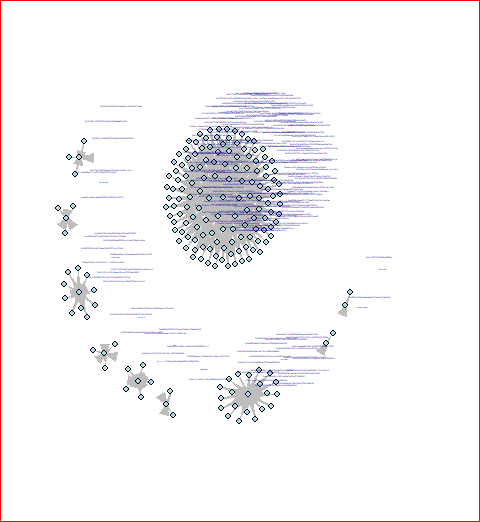
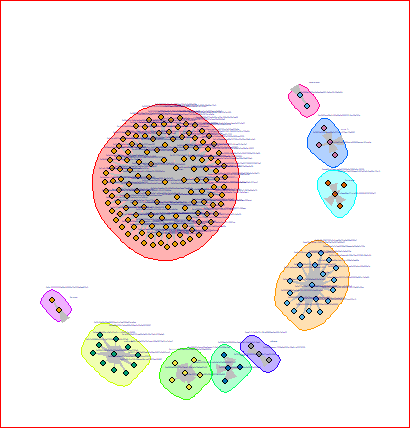
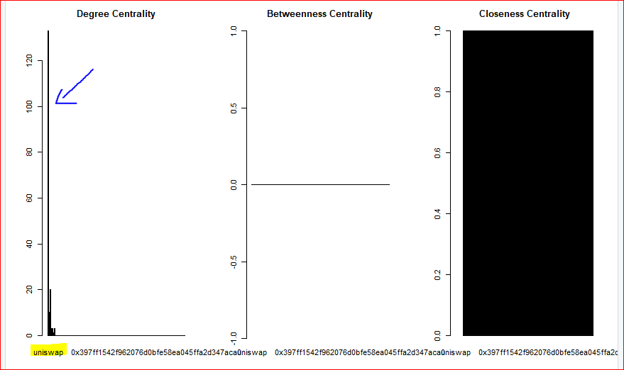
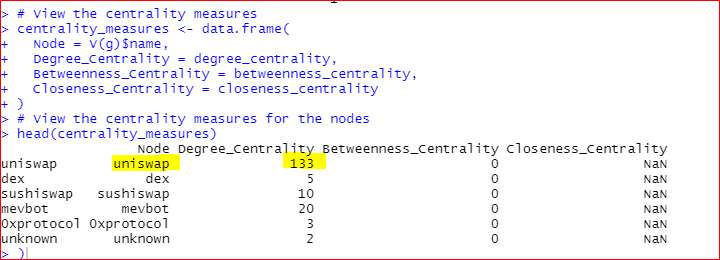

# Ethereum Network Analysis with R

A graph-analysis project exploring Ethereum exchange and stablecoin address data through directed-network visualization, centrality measures, and community detection.

**Tools shown:** R, tidyverse, readr, and igraph.

## Available materials

- [Project presentation](presentation/ethereum_network_analysis.pptx): 30-slide presentation containing code screenshots and analysis figures, with a title-only cover.
- [Methodology notes](docs/methodology.md): workflow and interpretation limits.
- Visual gallery of network structure, centrality, and community detection extracted from the presentation.

## Visual gallery

The figures below are preserved outputs from the project presentation. Click an image to open the full-size version.

<table>
<tr>
<td align="center" width="50%">
<h3>Directed network</h3>

Overview of the graph constructed in the analysis.

</td>
<td align="center" width="50%">
<h3>Walktrap communities</h3>

Colored groups show the community partition displayed in the slides.

</td>
</tr>
<tr>
<td align="center" width="50%">
<h3>Edge-betweenness clustering</h3>

A second view of the graph's community structure.

</td>
<td align="center" width="50%">
<h3>Centrality comparison</h3>

Original plots comparing the centrality measures.

</td>
</tr>
</table>

### Centrality results

The preserved output reports an out-degree of **133** for the `uniswap` label. It also contains zero betweenness values and undefined (`NaN`) closeness values for the displayed nodes. These figures are archived outputs, not newly recomputed measurements. See [methodology notes](docs/methodology.md) for graph-construction and interpretation limits.

## Topics covered

| Area | Methods shown in the presentation |
| --- | --- |
| Data preparation | CSV import, structure inspection, summaries, missing values, duplicates |
| Graph construction | Directed graph with igraph |
| Centrality | In-degree, out-degree, betweenness, closeness |
| Communities | Walktrap and edge-betweenness clustering |
| Representation | Adjacency matrix and important-node inspection |

## Data reference

The presentation references the [Stanford SNAP AlphaCore Ethereum Exchanges dataset](https://snap.stanford.edu/data/ethereum-exchanges.html), specifically `alphacore_labels_stablecoin.csv`. The original CSV and executable R files are not included in the recovered materials.

## Implementation status

This repository currently presents the project through its original slides, code screenshots, and figures. It is not a runnable R package or a complete reproduction of the transaction-network analysis. See the methodology notes before interpreting graph results.

## Contributors

The original presentation credits Mohamed Zoher Mohamed and Abdelrahman Mohamed Abdelfattah. Student identification numbers have been removed for public sharing. It is preserved as a team project; individual task ownership is not specified in the surviving materials.
